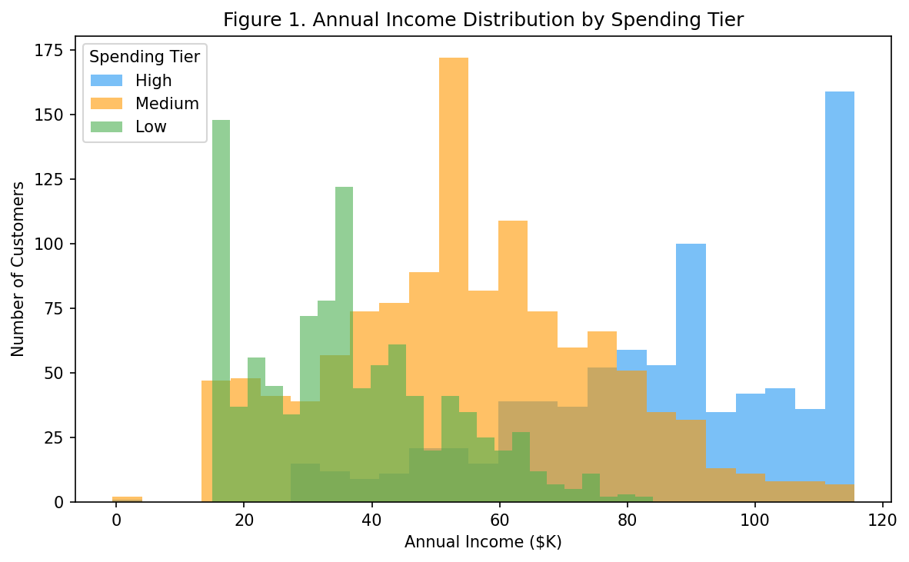
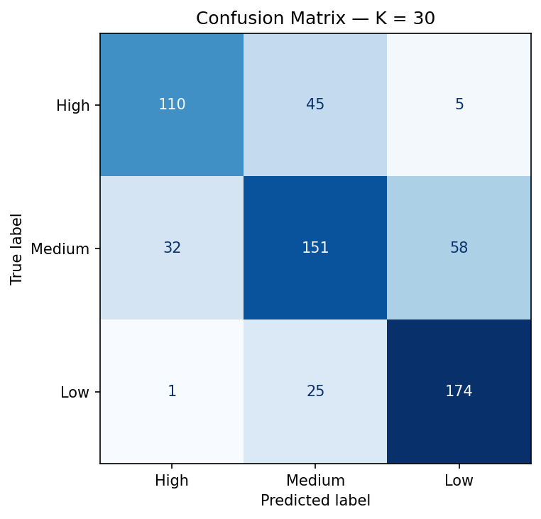
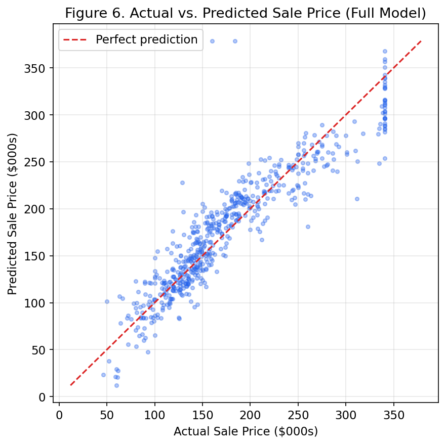
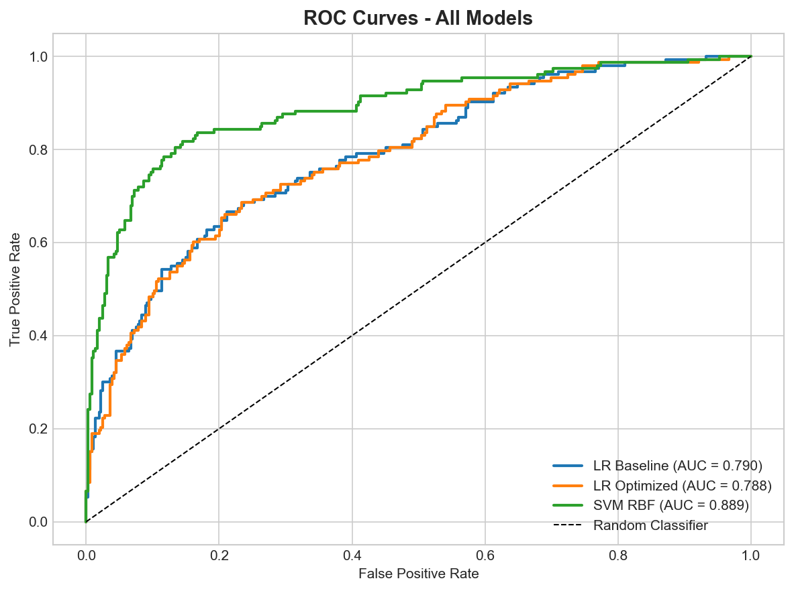

# Machine Learning — KNN Customer Segmentation and Car Insurance Outcome Prediction

Six weeks of predictive analytics, one repo: customer segmentation with K-nearest neighbours, house-price regression, loan-default and attrition classification, a churn neural network, and a final exam predicting car-insurance outcomes. Each week is a real business problem with its own dataset, models and report.

From Northeastern's ALY6020 Predictive Analytics course (instructor Justin Grosz, Spring 2026). Reports dated February–March 2026; final exam report dated 26 March 2026.

## In plain language

A business rarely has one kind of prediction problem. This course works through six of them, one per week:

1. **Who are our customers?** Group mall shoppers into segments with K-nearest neighbours.
2. **What is this house worth?** Predict Ames house prices with regression.
3. **Will this borrower default?** Predict loan defaults for a bank.
4. **Who will quit?** Predict employee attrition for an HR team.
5. **Who will cancel?** Predict telecom churn with a neural network.
6. **Final exam: will this driver make a claim?** Predict car-insurance outcomes with logistic regression, Random Forest and Gradient Boosting.

The through-line is the same every week: clean the data, handle the missing values honestly, train more than one model, and judge them on a held-out test set — not on the data they were trained on.

## Week 1 — KNN Customer Segmentation, Lakeview Mall

- **Dataset:** `mall_customers.csv` — 3,005 shoppers, 12 columns. Missing values: Age 150, Annual Income 180, Visit Frequency 120, Avg Transaction Value 90; filled with group-by-tier means.
- **Segments:** High 801 (26.7%), Medium 1,203 (40.0%), Low 1,001 (33.3%). High-tier shoppers average $85.89K income, 8.45 visits a month and a spending score of 70.62; low-tier shoppers average $36.23K income and 3.56 visits a month.
- **Model:** K-nearest neighbours on income, visit frequency and age, K = 5 / 15 / 30. Train 2,402, test 601. **K = 30 was best and is recommended: 72.38% accuracy** (K = 5: 71.05%, K = 15: 71.55%). F1 scores: High 0.73, Medium 0.80, Low 0.65.

## Week 2 — Ames Housing Price Prediction, Horizon Realty

- **Dataset:** `AmesHousing_15cols.csv` — 2,930 house sales, 2006–2010. Sale prices $12,789–$755,000; after capping outliers at ±2 standard deviations, $21,074–$340,587. Missing values are heavy in places (Fence missing in 80.5% of rows, Mas Vnr Type in 60.6%).
- **Models:** simple 3-feature model Adjusted R² **0.8113**, RMSE $30,259; full 9-feature model Adjusted R² **0.8538**, RMSE $26,807. Stepwise selection kept all 9 features. Overall Quality adds +$17,582 per point, living area +$43.72 per sq ft, house age −$384.36 per year. Correlations: Overall Quality r 0.82, living area 0.73, basement size 0.65, house age −0.60.

## Week 3 — Loan Default Prediction, SecureBank

- **Dataset:** `loan_default.csv` — 2,559 loans, 21 columns, default rate 29.9%. Train 2,047, test 512. Note: loan amounts include negative values (minimum −5,410 DM), a data-quality quirk worth flagging.
- **Model:** logistic regression baseline — accuracy **77.73%**, precision 0.6612, recall 0.5229, F1 0.5839, AUC 0.7898 (test set: 318 true negatives, 41 false positives, 73 false negatives, 80 true positives). The model catches about half of the defaults; the misses are the expensive ones, which is why recall matters more than accuracy here.

## Week 4 — HR Attrition Prediction, TalentFirst

- **Dataset:** `hr_attrition.csv` — 3,000 employees, 20 columns; 2,996 after removing 4 duplicate employee IDs. Attrition: Yes 865 (28.87%), No 2,131. Sales loses the most people (33.39%), Engineering the least (25.86%). Leavers average $7,633 a month vs $7,813 for stayers — pay is not the main story; job satisfaction is. Attrition is 44.6% at satisfaction level 1 and 49.1% at level 2, but only 14.2% at level 5. The report cites $13–43M a year in turnover cost.
- **Models:** unpruned decision tree 67.33% accuracy (F1 0.4368); pruned tree (max depth 5) 71.50% (F1 0.4203, top feature Job Satisfaction 0.4706); Random Forest (100 trees) **74.33%** accuracy but only 21.97% recall — it rarely predicts attrition, so it misses most leavers. No resampling or class weighting was applied, and the low recall is partly attributed to the class imbalance.

## Week 5 — Telco Churn, ConnectTel (neural network)

- **Dataset:** `telco_churn.csv` — 5,000 customers, 24 columns; churn Yes 1,386 (27.7%). After cleaning, 4,798 rows. Month-to-month contracts churn at 41.3% vs 9.5% for two-year contracts; customers with under 12 months' tenure churn at 36.8%. Churn costs $300–500 per lost customer, roughly $420,000–700,000 a year.
- **Models:** logistic regression baseline — test accuracy **76.56%**, F1 0.5731; simple neural network (16 neurons) 75.31%; deeper network (32–16 neurons) 70.63% on test despite 95.00% on train — a 0.2437 overfitting gap, the week's real lesson. The deeper network memorised the training data and generalised worse.

One-row discrepancy, flagged honestly: the notebook reports 4,798 cleaned rows; both Week 5 reports say 4,797. The cause was not established, so neither figure is presented as settled beyond this note.

## Week 6 — Final exam: Car Insurance Outcome Prediction

- **Dataset:** `car_insurance (1) (1).csv` — 10,000 drivers, 17 columns. Missing: credit score 982 (9.8%), annual mileage 957 (9.6%), both filled with medians (credit score median 0.5250, mileage median 12,000). 80/20 split, random state 42; test set 2,000 drivers.
- **Logistic regression** (with Wald p-values): **10 variables significant at p ≤ 0.05.** Largest effects: vehicle ownership −1.6562, driving experience −1.5526, gender +0.8542, married −0.4304, past accidents −0.2164, speeding violations +0.0949, credit score −0.8836.
- **Ensembles (1,000 estimators each), test accuracy — cross-checked exactly against the confusion matrices:**

| Model | Accuracy | Confusion matrix (TN / FP / FN / TP) |
|---|---|---|
| Logistic Regression | **80.00%** | 1212 / 155 / 245 / 388 |
| Random Forest | 78.80% | 1201 / 166 / 258 / 375 |
| Gradient Boosting | 79.45% | 1192 / 175 / 236 / 397 |

Logistic regression wins the final exam — the simplest model, with interpretable coefficients, beats both ensembles. Random Forest feature importance: credit score 0.2448, driving experience 0.1282, annual mileage 0.1221.

## A note on the accuracy numbers

An earlier note in the project files said these accuracies were only runtime prints and should not be quoted. That turned out to be wrong: the accuracies are stored in the notebook outputs and in the reports, and the final-exam figures above were cross-checked exactly against the confusion matrices (for example, (1212 + 388) / 2000 = 80.00%). They are quoted here because they are verified, not because they were assumed.

## What is in this repo

- `week-1-knn-customer-segmentation/` — KNN notebook + report.
- `week-2-ames-housing-price-prediction/` — regression notebook + report (docx and PDF).
- `week-3-loan-default-prediction/` — loan-default notebook, Python script + report.
- `week-4-hr-attrition-prediction/` — attrition notebook (the revised version is canonical), Python script + report.
- `week-5-telco-churn-neural-network/` — churn neural-network notebook + report.
- `week-6-final-exam-car-insurance/` — final-exam code (`final_exam_code.py` + notebook) and the polished final-exam report (26 March 2026).
- `data/` — the six datasets exactly as the code reads them, once each: `mall_customers.csv`, `AmesHousing_15cols.csv`, `loan_default.csv`, `hr_attrition.csv`, `telco_churn.csv`, `car_insurance (1) (1).csv` (the doubled "(1)" is the literal filename on the Mac and in the code). Note: in the repo they live in `data/`; on the Mac they sat beside the notebooks, so the notebooks' relative paths differ — the README notes the change.
- `images/` — 23 real charts: KNN confusion matrices and tier plots, Ames regression plots, loan ROC curves, attrition EDA and feature importance, churn EDA and model comparison.

## How to use it

1. Pick a week folder and read its report first — each one states the business question, the cleaning, and the result.
2. Run the notebook or Python script with the matching CSV from `data/`.
3. Compare models within a week on the test-set figures quoted above, not on training accuracy — Week 5 is the cautionary tale for that.

## Tools

Python, pandas, scikit-learn (KNN, logistic regression, decision trees, Random Forest, Gradient Boosting, HistGradientBoosting), TensorFlow/Keras (Week 5 neural networks), matplotlib/seaborn.

## What was left out, and why

- Earlier-draft reports for Weeks 1, 2, 3 and 6 — they describe earlier runs with slightly different metrics; the staged report for each week is the one matching its canonical code run. Do not mix draft numbers with final numbers.
- Working copies and condensed duplicate notebooks (for example the 5-cell Week 1 notebook containing both the early and final runs) — superseded, not double-uploaded.
- An interview-prep PDF found in the Week 3 folder and a file that appears to be someone else's work (JSG) — not Dev's project work.
- The original (non-revised) Week 4 notebook — the revised version is canonical; both notebooks' first outputs are identical.

## Conclusion

Across six different problems, the same patterns repeat: the simplest interpretable model often wins or comes close (logistic regression takes the final exam), accuracy alone misleads whenever a class is rare (attrition recall 22%, loan-default recall 52%), and a model that looks perfect on training data can fail on new data (the deeper churn network's 95% train vs 71% test). The skill this course builds is not running one algorithm — it is choosing, checking and honestly reporting the right one for each problem.
